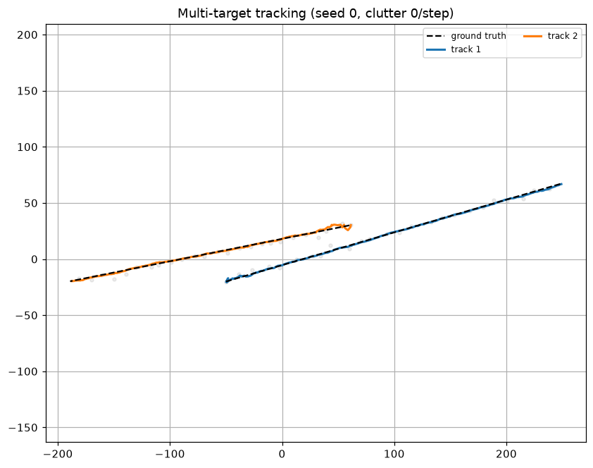
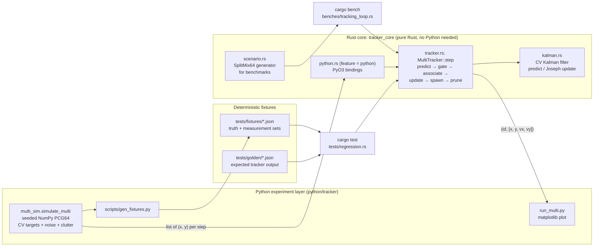
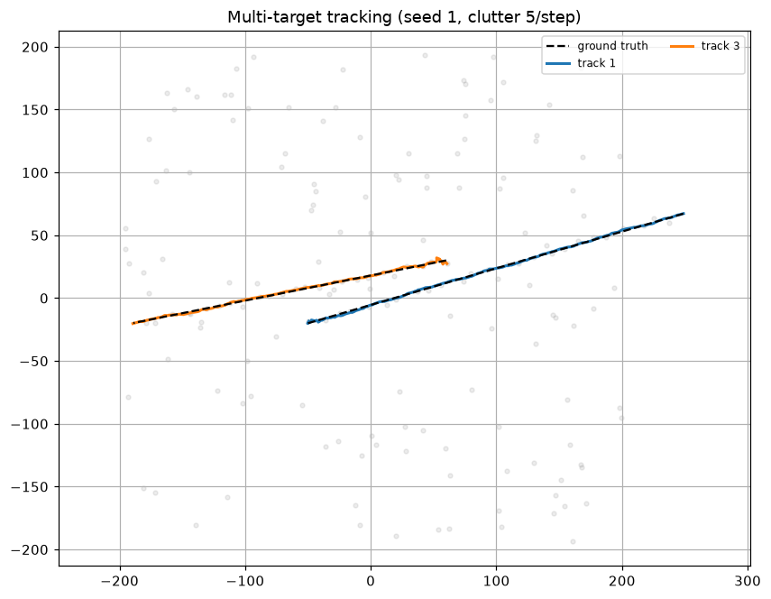

# Sensor Fusion Tracker Sim

A multi-target tracker written in Rust and driven by a seeded Python simulation.
NumPy generates constant-velocity targets with noisy, unlabelled detections and
optional clutter. A Rust core (exposed to Python through PyO3) tracks them with
per-track Kalman filters, Mahalanobis gating and greedy nearest-neighbour
association.

This is a learning and portfolio project, built and tested only in simulation.
It has not been run on real sensor data or deployed anywhere.



| What you can check | Where |
|---|---|
| How it is designed | [Architecture](#architecture) |
| That the maths is right | [Unit tests](#unit-tests), `src/kalman.rs` |
| That tracking works end to end, within stated tolerances | [Regression tests and tolerances](#regression-tests-and-tolerances) |
| A bug the tests found, and its fix | [Association bug found by the tests](#association-bug-found-by-the-tests) |
| A profiled, measured, reproducible optimisation | [Performance](#performance) |

---

## Architecture



### One tracking step (`MultiTracker::step`)

1. **Predict**: each track's filter moves forward one step: \(x \leftarrow Fx\), \(P \leftarrow FPF^\top + Q\).
2. **Gate**: a track–measurement pair is a candidate if \(d^2 = y^\top S^{-1} y \le 9.21\) (the 99% point of \(\chi^2\) with 2 degrees of freedom), where \(y\) is the innovation and \(S = HPH^\top + R\).
3. **Associate**: candidates are sorted by \(d^2 + \ln|S|\) (negative log-likelihood up to a constant), and the best unused pair is taken each time. Ties are broken by index, so the result is fully deterministic.
4. **Update**: matched tracks run the Kalman update in Joseph form, which keeps \(P\) symmetric positive-definite.
5. **Spawn and prune**: each unmatched detection starts a new track with \(P_0 = 1000I\). A track is deleted after it misses more than `max_missed` steps in a row.

### Layout

```
src/
  kalman.rs      CV model (F, Q, H), filter, Mahalanobis distance, unit tests
  tracker.rs     MultiTracker, gating/association, unit and equivalence tests
  scenario.rs    deterministic generator for benchmarks (no Python)
  python.rs      PyO3 bindings (only built with --features python)
python/tracker/  simulation, demo plot
scripts/         fixture generation, before/after benchmark script
tests/           regression.rs (Rust), test_smoke.py (Python), fixtures/, golden/
benches/         Criterion benchmark for the tracking loop
docs/            flamegraphs before and after the optimisation
```

The core does not depend on Python. The `python` Cargo feature, which maturin
turns on, adds the bindings. Plain `cargo test` and `cargo bench` need only a
Rust toolchain.

---

## Usage

### Rust only (tests and benchmarks)

```bash
cargo test                      # unit + regression tests (no Python needed)
cargo bench --bench tracking_loop
```

```rust
use tracker_core::{MultiTracker, TrackerConfig};

let mut trk = MultiTracker::new(TrackerConfig { dt: 0.1, ..Default::default() });
for detections in frames {                 // each frame: &[(f64, f64)]
    for t in trk.step(&detections)? {
        println!("{} {:?}", t.id, t.kf.state()); // [x, y, vx, vy]
    }
}
```

### Python (simulation and plots)

```bash
python -m venv .venv && source .venv/bin/activate
pip install -U pip maturin numpy matplotlib pytest
maturin develop --release        # builds the Rust extension into the venv
python -m tracker.run_multi                                    # interactive plot
python -m tracker.run_multi --seed 1 --clutter 5 --save out.png
pytest -q
```

```python
import tracker_core
from tracker.multi_sim import simulate_multi

truth, measurements = simulate_multi(seed=0, n=250, clutter_per_step=5)
mt = tracker_core.MultiTrackerCV(dt=0.1, q=1.0, r_pos=4.0, gate_d2=9.21, max_missed=6)
for m in measurements:
    tracks = mt.step(m)            # [(track_id, [x, y, vx, vy]), ...]
```

With 5 clutter points per step (seed 1), only the two real targets produce long-lived tracks:



---

## Validation

### Unit tests

There are 20 unit tests in `src/kalman.rs` and `src/tracker.rs`. They cover:

- **State prediction**: one step of `predict` matches \(x + v\,\Delta t\) exactly. Ten steps of 0.1 s match one step of 1 s. Starting from \(P = 0\), one predict gives exactly \(Q\). \(Q\) is symmetric, positive semi-definite and scales linearly with `q`.
- **Filtering**: an update moves the estimate toward the measurement and shrinks the position covariance. A diagonal case matches the hand-computed gain \(k = p/(p+r)\). After 10,000 steps, \(P\) is still symmetric and positive-definite. On a noise-free target, velocity converges to within \(10^{-3}\). A singular \(S\) returns an error and does not panic.
- **Association**: new tracks are spawned, IDs stay stable when measurement order is shuffled, out-of-gate detections spawn new tracks, tracks are pruned after `max_missed` steps, and the greedy step picks the closest pair first. One test covers the young-track bug described [below](#association-bug-found-by-the-tests).
- **Optimisation equivalence**: the fast gating path produces exactly the same candidate pairs as the original brute-force path, over 60 random steps (see [Performance](#performance)).

### Regression tests and tolerances

`scripts/gen_fixtures.py` uses the seeded Python simulator to write three
fixtures to `tests/fixtures/`. Each fixture holds the scenario parameters,
ground truth and the exact measurement sets. `tests/regression.rs` loads them,
runs the Rust tracker, and checks two things.

**1. Accuracy envelopes against ground truth.** The first 10 steps are a warm-up
and are not scored, because new tracks start with zero velocity. After that, at
each step, each true target is matched to the nearest track with at least 3
hits within 10 m.

| Scenario (seed) | Metric | Measured | Tolerance |
|---|---|---|---|
| `two_targets_clean` (0) | position RMSE | 0.78 / 0.94 m | ≤ 1.2 m |
| | velocity RMSE | 0.41 / 0.87 m/s | ≤ 1.5 m/s |
| | coverage / ID switches | 100% / 0 | 100% / 0 |
| `two_targets_clutter` (1), 5 clutter/step | position RMSE | 0.81 / 0.88 m | ≤ 1.2 m |
| | velocity RMSE | 0.42 / 0.49 m/s | ≤ 1.0 m/s |
| | coverage / ID switches | 100% / 0 | ≥ 99% / 0 |
| `three_targets_crossing` (7), all three meet near the origin | position RMSE | 0.72–0.95 m | ≤ 1.5 m |
| | velocity RMSE | 1.13–1.67 m/s | ≤ 2.5 m/s |
| | coverage / ID switches | 100% / 2 each | ≥ 98% / ≤ 2 |

Measurement noise is \(\sigma = 2\) m per axis. Position RMSE should come out
well below 2 m, so the tolerances leave roughly 25–50% headroom over the
measured values. That headroom absorbs legitimate numerical changes while still
catching real tracking regressions.

The 2 ID switches in the crossing scenario are expected. All three targets
pass within a few metres of each other at the same moment, and greedy
nearest-neighbour association cannot keep identities through that. Fixing it
would need JPDA or MHT (see [Limitations](#limitations)).

**2. Golden snapshot.** `tests/golden/*.json` records the tracker's output for
each scenario: the number of tracks at every step, the IDs, the final states
and a checksum over the whole trajectory. The test compares new output against
it with an absolute tolerance of \(10^{-9}\). On one machine the pipeline is
bit-for-bit deterministic, and the \(10^{-9}\) allowance covers FMA or libm
differences between CPUs. Any change in behaviour fails this test, including
one introduced by a performance change. To update the snapshot on purpose, run
`UPDATE_GOLDEN=1 cargo test --test regression`.

**Determinism.** NumPy's `default_rng` (PCG64) produces the same stream for a
given seed on every platform. `pytest` regenerates the fixtures and checks they
are byte-identical to the committed files. Another test runs the
Python → PyO3 → Rust path and checks it matches the Rust golden output.

### Association bug found by the tests

The first version of the regression suite failed on the clean scenario, with
11 ID switches on a single target. The cause was that association ranked pairs
by raw \(d^2\). A newly spawned track has a huge covariance (\(P_0 = 1000I\)),
so almost any detection has a small \(d^2\) against it. That let new tracks take
detections away from established tracks. Ranking by \(d^2 + \ln|S|\) (the
Gaussian negative log-likelihood) penalises the uncertain track and fixes it.

| Scenario | Metric | Raw \(d^2\) cost | \(d^2 + \ln\lvert S\rvert\) cost |
|---|---|---|---|
| clean | ID switches (target 1 / 2) | 11 / 3 | **0 / 0** |
| clean | position RMSE | 1.36 / 1.04 m | **0.78 / 0.94 m** |
| clutter | ID switches | 22 / 19 | **0 / 0** |
| clutter | velocity RMSE | 2.88 / 7.90 m/s | **0.42 / 0.49 m/s** |

`young_track_does_not_steal_from_established_track` reproduces the bug in a
few lines. It fails with the old cost and passes with the new one.

---

## Performance

### Benchmark

`benches/tracking_loop.rs` uses Criterion. Each iteration runs a fresh tracker
through 100 steps of a fixed-seed scenario, so spawning, association and
pruning are all timed. Measurements are generated before timing starts. Clutter
is uniform over a 4 km × 4 km area. Each clutter point starts a short-lived
track, so the number of live tracks \(T\) grows to several times the target
count, and that pressure is the point of the benchmark.

### Bottleneck: all-pairs gating

Profiling the largest case (`cargo flamegraph --bench tracking_loop -- --bench --profile-time 10 tracking_loop/200t_200c`):

- [`docs/flamegraph-before.svg`](docs/flamegraph-before.svg): about **82%** of samples were in the body of `MultiTracker::step`, almost all of it the gating loop. That loop computed a 2×2 inverse and a Mahalanobis product for every one of the \(T \times M\) track–measurement pairs. The Kalman predict and update, and the sort, took only a few percent each.

My first fix was a micro-optimisation: compute \(S^{-1}\) once per track and use a
closed-form scalar \(d^2\). It was not faster. At about 1 ns per pair the
arithmetic was already cheap, and the real cost was the \(O(T \cdot M)\) number
of pairs. I reverted it, so it is not in the history.

### Optimisation: exact sort-and-sweep gating window

Each step now sorts the measurements by \(x\) once. For each track, a binary
search finds the measurements inside an \(x\)-window, and \(y\) is checked
before \(d^2\) is computed. The window is **exact**: for the ellipse
\(y^\top S^{-1} y \le g\), the largest possible offset in \(x\) is
\(\sqrt{g\,S_{xx}}\) (and \(\sqrt{g\,S_{yy}}\) in \(y\)), so no pair inside the
gate is skipped. Candidate pairs are fully sorted with index tie-breaks, so the
output is identical. Three checks confirm this: the golden snapshots,
`windowed_gating_matches_brute_force`, and the Python parity test.

### Results

The table compares commit `perf-baseline` (tag) with the optimised `HEAD`.
Times are Criterion medians for 100 steps on an Intel Xeon @ 2.90 GHz (2 vCPU,
shared cloud VM). Treat changes under about ±5% as noise.

| Scenario (targets / clutter per step) | Before | After | Change |
|---|---|---|---|
| 2 / 0 | 27.4 µs | 31.5 µs | +13% (slower) |
| 20 / 20 | 1.82 ms | 1.65 ms | −6% |
| 100 / 100 | 21.4 ms | 9.44 ms | **−56% (2.3×)** |
| 200 / 200 | 72.3 ms | 20.6 ms | **−72% (3.5×)** |

- [`docs/flamegraph-after.svg`](docs/flamegraph-after.svg): the remaining time is now spread across the Kalman maths (4×4 products in `predict` and `innovation`, about 30%), sorting and the reduced gating loop. No single hotspot is left.
- **Trade-off:** with 2 targets and no clutter, sorting costs more than it saves, and that case is about 4 µs slower per 100 steps. A size threshold that falls back to brute force would recover it. I left it out to keep one code path.

### Reproducing

```bash
scripts/bench_compare.sh            # benchmarks tag perf-baseline, then HEAD against it
cargo install flamegraph            # needs perf (linux-tools) on Linux
cargo flamegraph --bench tracking_loop -o flamegraph.svg -- \
    --bench --profile-time 10 tracking_loop/200t_200c
```

The script checks out the baseline in a temporary git worktree and uses the
current benchmark harness for both runs. Each run gets its own build directory,
so Cargo cannot reuse the wrong binary. Criterion prints the change and its
p-value. Absolute times will vary by machine. The size of the speed-up at
100/100 and 200/200 should not.

---

## Limitations

- Constant-velocity motion, position-only measurements, isotropic noise and a single 2D sensor. No real sensor data.
- Greedy nearest-neighbour association. It cannot keep identities through close crossings (see the crossing scenario). Global assignment (Hungarian), JPDA or MHT would be the next step.
- There is no track confirmation logic. Every unmatched detection starts a track, and consumers filter by `hits` or track length. The demo plot shows only tracks that last at least 50 steps.
- Benchmarks come from one shared cloud VM. They show relative improvement, not absolute throughput.

## CI

GitHub Actions runs `cargo fmt --check`, `clippy -D warnings`, `cargo test` and
`cargo bench --no-run`. It also builds the wheel with maturin and runs
`pytest`. Benchmarks are only compiled in CI, not run, because shared runners
are too noisy for timing.

## License

MIT
